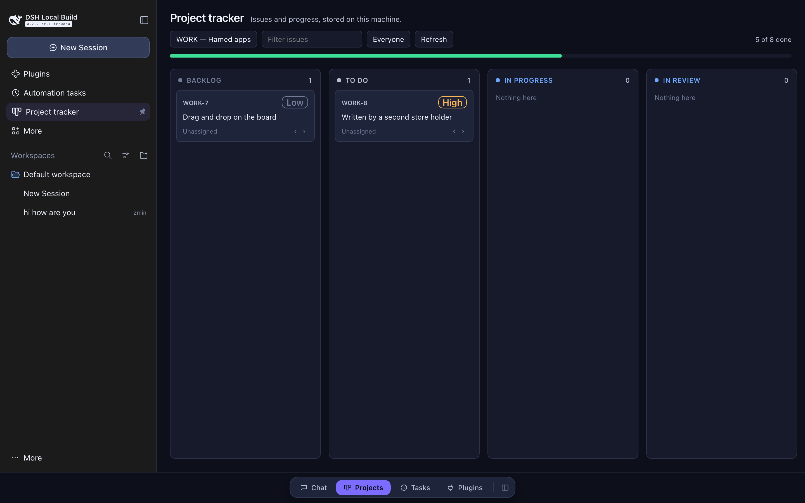
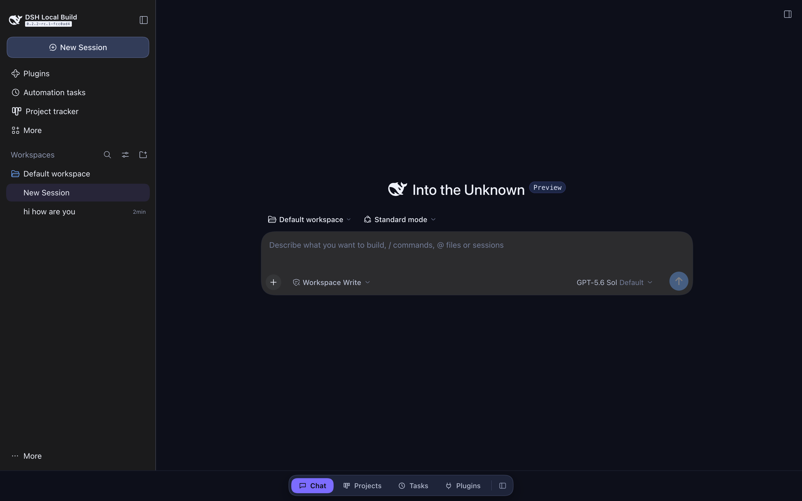

<div align="center">

# DeepSeek Harness plugins

**Three out-of-tree plugins for the DeepSeek Harness Web UI: a project tracker, the Midnight theme and a tab bar.**




</div>

Each plugin lives outside the Harness checkout, so pulling upstream never conflicts with it.

## Screenshots

Screenshots are from the Harness Web UI running locally on macOS.

| Project tracker | Home with the Midnight theme |
|---|---|
|  |  |

## The plugins

| Plugin | Package | What it adds |
|---|---|---|
| [`projects/`](projects/README.md) | `@local/dsh-projects` | A local issue tracker: a board panel (projects, six columns, priorities, progress bar, filters) and three agent tools (`issue_board`, `issue_write`, `project_write`) that act on the same store. |
| [`theme/`](theme/README.md) | `@local/dsh-theme` | The *Midnight* theme: deep indigo surfaces and a violet accent. It overrides 118 of the Harness's own `--dsw-alias-*` design tokens, so layout never breaks. |
| `shell/` | `@local/dsh-shell` | A tab bar (Chat · Projects · Tasks · Plugins) for switching between the chat and global panels. Only panels that are actually registered get a tab. |

All three ship dictionaries in eight languages: en, de, es, fr, ja, pt, ru, zh.

### Project tracker highlights

- A card moved by hand and an issue moved by the agent go through the same Host store, so they're the same operation.
- Cards move one column at a time with `‹` / `›`, applied optimistically and then reconciled with the Host.
- Free-text and assignee filters narrow the board.
- Styling uses only theme tokens, so the tracker follows the host's light/dark theme.

## Install

From a shell, for the profile your Harness runs with:

```bash
git clone https://github.com/MohamedHamed163/dsh-plugins.git
dsh plugin --profile web add link:$PWD/dsh-plugins/projects
dsh plugin --profile web add link:$PWD/dsh-plugins/theme
dsh plugin --profile web add link:$PWD/dsh-plugins/shell
```

Then restart the Harness. The project tracker needs two extra steps (linking the runtime and
mounting its agent tools). See [`projects/README.md`](projects/README.md).

## Tests

```bash
./projects/tests/run.sh
./theme/tests/run.sh
./shell/tests/run.sh
```

## Layout

| Path | Contents |
|---|---|
| `projects/` | Board view, store, client, agent tools, locales, tests |
| `theme/` | Palette and token overrides, locales, tests |
| `shell/` | Tab bar, locales, tests |
| `docs/screenshots/` | README images |
